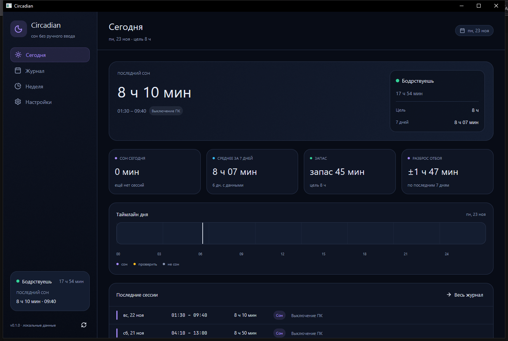
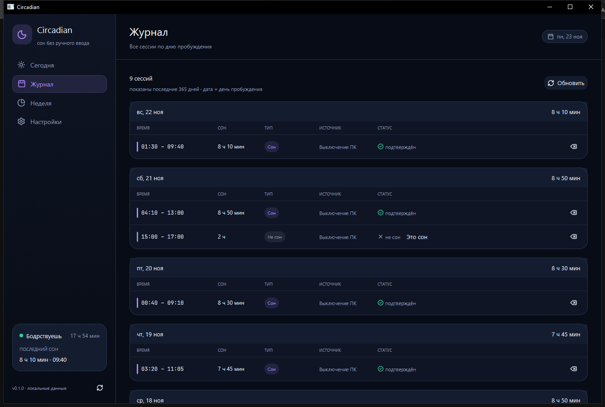
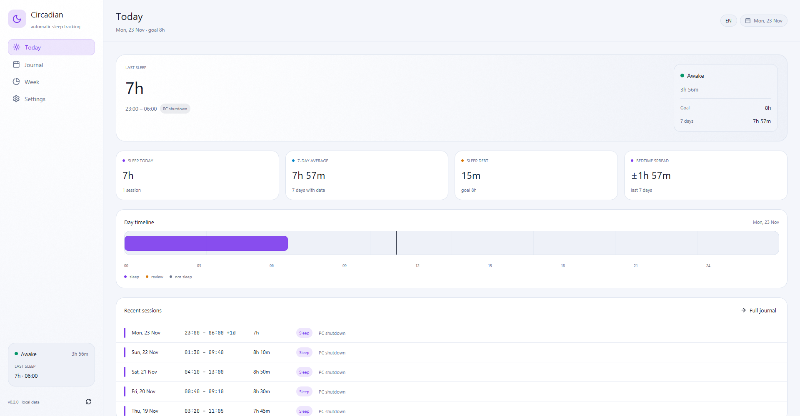

# Circadian

Нативный трекер сна для Windows. Выключил ПК - сон, включил - пробуждение.
Rust, GPUI и SQLite, без WebView, облака и телеметрии.

[](https://github.com/drawiks/circadian/actions/workflows/ci.yml)
[](LICENSE)

## Скриншоты

| Сегодня | Журнал |
|---|---|
|  |  |

| Неделя | Светлая тема |
|---|---|
|  |  |

## Возможности

- Фоновый демон в трее: почти нулевое потребление, без окна и консоли.
- Автозапуск при входе в Windows, ручные «Я ложусь спать» и «Я проснулся», пауза.
- Автоматические сессии: выключение ПК, ребут, сон/гибернация, пропажа питания.
- Журнал по дням пробуждения: отбой, подъём, длительность, источник, статус.
- Недельный отчёт: среднее, недосып, регулярность, самый длинный/короткий сон, факты.
- Тёмная и светлая темы, кастомный интерфейс Circadian.
- Все данные локально: `%LOCALAPPDATA%\Circadian\circadian.db`.

## Установка

1. Скачай `Circadian-Setup-*.exe` из [Releases](https://github.com/drawiks/circadian/releases/latest).
2. Запусти установщик. Установка идёт в `%LOCALAPPDATA%\Programs\Circadian` без администратора.
3. Оставь включённой галочку «Запустить Circadian» - демон сразу начнёт отслеживание.

Установщик не подписан сертификатом. SmartScreen может показать предупреждение:
«Подробнее» → «Выполнить всё равно».

Есть portable-вариант: распакуй `Circadian-*-portable.zip` в постоянную папку и запусти
`circadian.exe`. Автозапуск включается при первом запуске и отключается в настройках.

Обновление ставится поверх и сохраняет историю. Удаление программы не удаляет данные:
установщик спросит, удалять ли историю сна.

## Как это работает

Начало сна - системное событие выключения или suspend. Для `shutdown -s -t 2400`
это момент фактического выключения, когда таймер уже досчитал и сон начался.
Пробуждение - старт демона после загрузки, вход пользователя или resume.

| Перерыв | Что происходит |
|---|---|
| Меньше 45 минут | Игнорируется: ребут, обновление, короткий уход |
| 45 минут – 4 часа | Появляется карточка «Нужно подтвердить»: сон / не сон |
| 4 часа и больше | Считается сном автоматически |
| Sleep / hibernate ПК | От 4 часов - сон; 45 минут–4 часа - подтверждение |
| Демон не работал, а ПК был включён | Это пробел в данных, а не сон |

Пороги настраиваются. Сессия относится к **дню пробуждения**: сон с 03:00 до 11:00
принадлежит 11-му числу. Несколько сессий за день поддерживаются.

Если перерыв оказался не сном, нажми «Не сон» в журнале. Ошибочное «Не сон»
возвращается кнопкой «Это сон». Удаление сессии требует подтверждения.

## Управление

- **Трей** - открыть окно, ручные сон/пробуждение, пауза на 4 часа, автозапуск, выход.
- **Сегодня** - последний основной сон, статус, среднее за 7 дней, недосып, таймлайн.
- **Журнал** - все сессии, подтверждение перерывов, удаление.
- **Неделя** - график по дням, сравнение с прошлой неделей, факты.
- **Настройки** - цель сна, пороги, suspend, тема, автозапуск, папка данных, экспорт CSV.

## Приватность

Circadian не делает сетевых запросов. В базе только время сессий, источник, статус и
заметки. Экспорт CSV выполняется по кнопке в настройках. Удалить всё можно вместе с
папкой `%LOCALAPPDATA%\Circadian` или через удаление программы с подтверждением.

## Сборка

Нужен Rust `1.98.1` (закреплён в `rust-toolchain.toml`) и Windows SDK/MSVC.

```powershell
cargo test -p circadian-core
cargo clippy --workspace --all-targets -- -D warnings
cargo build --release -p circadian-app -p circadian-daemon
```

Release-сборка и установщик делаются на Windows или в CI: GPUI компилирует
HLSL-шейдеры на этапе сборки. Из WSL можно собрать только debug-превью:

```bash
cargo install cargo-xwin
rustup target add x86_64-pc-windows-msvc
cargo xwin build --target x86_64-pc-windows-msvc -p circadian-app -p circadian-daemon
```

Установщик собирается Inno Setup 6:

```powershell
winget install JRSoftware.InnoSetup
$iscc = Get-ChildItem `
  "${env:ProgramFiles(x86)}\Inno Setup 6\ISCC.exe", `
  "$env:LOCALAPPDATA\Programs\Inno Setup 6\ISCC.exe" `
  -ErrorAction SilentlyContinue | Select-Object -First 1
& $iscc "/DAppVersion=0.1.1" "/DBinDir=..\target\release" "installer\circadian.iss"
```

## CI и релизы

GitHub Actions на `windows-latest` проверяет форматирование, тесты ядра, clippy и
release-сборку, затем собирает установщик, portable ZIP и `SHA256SUMS.txt`.

Пуш тега `vX.Y.Z` создаёт GitHub Release с этими файлами. Версия тега должна
совпадать с версией в `Cargo.toml`.

## Ограничения

- «ПК выключен» не всегда значит «человек спит»: длинный дневной перерыв можно
  подтвердить как «не сон».
- Пробуждение фиксируется при старте демона/входе в Windows, а не в момент нажатия
  кнопки питания.
- Если демон не работал, появится пробел в данных.
- Это не медицинский сервис и не диагностика расстройств сна.

## Лицензии

Проект распространяется по MIT - см. [LICENSE](LICENSE).
Сторонние компоненты и шрифты - в [THIRD_PARTY_NOTICES.md](THIRD_PARTY_NOTICES.md)
и папке [licenses](licenses/).
