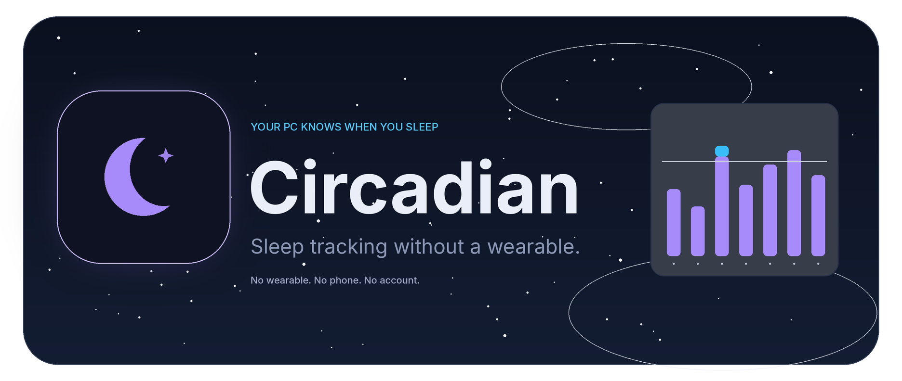
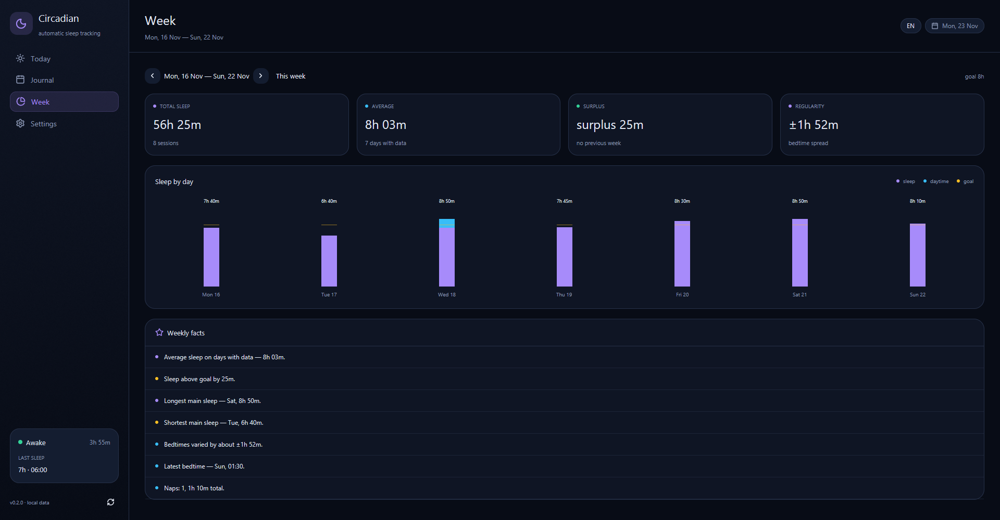

<p align="center">
  
</p>

<p align="center">
  <a href="#screenshots">Screenshots</a> •
  <a href="#install">Install</a> •
  <a href="#how-it-works">How it works</a> •
  <a href="#privacy">Privacy</a> •
  <a href="#faq">FAQ</a> •
  <a href="#build-from-source">Build</a> •
  <a href="README.ru.md">Русский</a>
</p>

<p align="center">
  <a href="https://github.com/drawiks/circadian/releases/latest"></a>
  <a href="https://github.com/drawiks/circadian/actions/workflows/ci.yml"></a>
  
  <a href="LICENSE"></a>
</p>

Circadian is a sleep tracker for your PC. Turn off your computer when you go to bed, turn it back on in the morning, and Circadian shows how long you slept, your sleep debt, and how regular your schedule is.

No wearable. No phone. No account. Everything stays on your computer.

**[Download for Windows](https://github.com/drawiks/circadian/releases/latest)**

## Screenshots

| Today | Journal |
|---|---|
|  |  |

| Week | Light theme |
|---|---|
|  |  |

## What you get

- **Automatic sleep tracking.** PC shutdown is bedtime. The next startup is wake-up.
- **No wearable, no phone, no account.** Nothing to charge, wear, or sign into.
- **A report you can read.** Weekly average, sleep debt, bedtime spread, longest and shortest nights, and a short list of facts.
- **Built for real PC use.** Reboots, Windows updates, suspend, hibernation, and power loss are handled.
- **Local by design.** SQLite in `%LOCALAPPDATA%\Circadian`. No network calls, no telemetry.
- **Native Windows UI.** English and Russian interface, dark and light themes, system tray, and start with Windows.

## How it works

1. You shut down your PC as part of going to bed.
2. Circadian records the moment of shutdown as the start of sleep.
3. On the next startup it closes the session and adds it to your journal.

If a gap is too short to be a night's sleep, Circadian asks instead of guessing:

| Gap | Result |
|---|---|
| Under 45 minutes | Ignored: reboot, update, quick break |
| 45 minutes to 4 hours | Needs review: sleep or not sleep |
| 4 hours or more | Counted as sleep |
| PC suspend / hibernate | Counted as sleep when long enough |
| Daemon was not running | Data gap, not sleep |

A session belongs to the **day you woke up**. Sleep from 03:00 to 11:00 belongs to the 11th. Naps and multiple sessions per day are supported.

## Install

Download `Circadian-Setup-*.exe` from [Releases](https://github.com/drawiks/circadian/releases/latest). It installs per user in `%LOCALAPPDATA%\Programs\Circadian` and does not require administrator rights.

The installer is not code-signed, so SmartScreen may warn you. Choose **More info → Run anyway**.

There is also a portable ZIP: extract it somewhere permanent and run `circadian.exe`. Updates can be installed over the previous version and keep your history. Uninstalling removes the app, startup entry and shortcuts, but leaves your sleep data unless you choose to delete it.

Circadian needs Windows 10 version 1903 or newer. Windows 11 is supported.

## Privacy

Sleep data is personal. Circadian does not create an account, does not send anything to a server, and does not include analytics. Your history is stored in a local SQLite database:

```text
%LOCALAPPDATA%\Circadian\circadian.db
```

You can export every session to CSV from Settings, and delete the database at any time. Uninstalling the app does not delete your history unless you confirm it.

## FAQ

**Why is there no data yet?**

Circadian starts tracking after the first shutdown or suspend. Until then the journal is empty. You can leave the daemon running in the tray; no manual input is required.

**I put my PC to sleep instead of shutting it down.**

Suspend and hibernation are tracked as sleep when the gap is long enough. Short gaps are treated as a break.

**I rebooted or installed Windows updates.**

Reboots under 45 minutes are ignored, so a quick restart does not become a fake sleep session. A long update can appear as a review item; mark it as not sleep.

**Where is my data?**

`%LOCALAPPDATA%\Circadian`. The path is shown in Settings, along with an export button.

**Does it send anything?**

No. There is no account, cloud sync, update ping, or telemetry.

**Is this a medical device?**

No. Circadian records timing and patterns. It is not a diagnosis or treatment tool.

## Build from source

Release builds and the installer are built on Windows or in CI. GPUI compiles its HLSL shaders during the release build, so Linux-to-Windows release builds are not supported.

<details>
<summary>Windows</summary>

```powershell
rustup toolchain install 1.98.1
cargo test -p circadian-core
cargo clippy --workspace --all-targets -- -D warnings
cargo build --release -p circadian-app -p circadian-daemon
```

Build the installer with Inno Setup 6:

```powershell
winget install JRSoftware.InnoSetup
$iscc = Get-ChildItem `
  "${env:ProgramFiles(x86)}\Inno Setup 6\ISCC.exe", `
  "$env:LOCALAPPDATA\Programs\Inno Setup 6\ISCC.exe" `
  -ErrorAction SilentlyContinue | Select-Object -First 1
& $iscc "/DAppVersion=0.2.0" "/DBinDir=..\target\release" "installer\circadian.iss"
```

</details>

<details>
<summary>WSL: debug preview only</summary>

```bash
cargo install cargo-xwin
rustup target add x86_64-pc-windows-msvc
cargo xwin build --target x86_64-pc-windows-msvc -p circadian-app -p circadian-daemon
```

Use the debug build for UI preview. Releases and installers should come from CI or a Windows build.

</details>

## Releases

Pushing a tag like `v0.2.0` runs CI, builds the unsigned Windows installer and portable ZIP, and publishes them with `SHA256SUMS.txt`. The tag version must match the version in `Cargo.toml`.

## Under the hood

Rust, [GPUI](https://gpui.rs), GPUI Kit and SQLite. The tray daemon uses Win32 power events and stays idle at 0% CPU. The UI is native Direct3D — there is no WebView.

## License

MIT. See [LICENSE](LICENSE). Third-party notices and font licenses are in [THIRD_PARTY_NOTICES.md](THIRD_PARTY_NOTICES.md) and [licenses](licenses/).

If Circadian is useful to you, a star helps other people find it.
