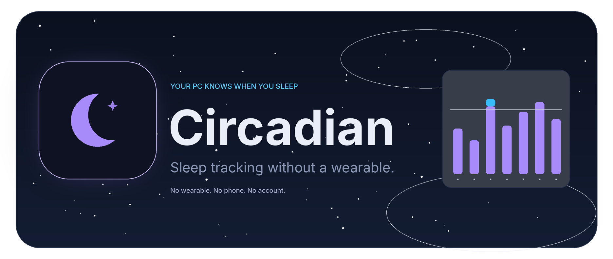
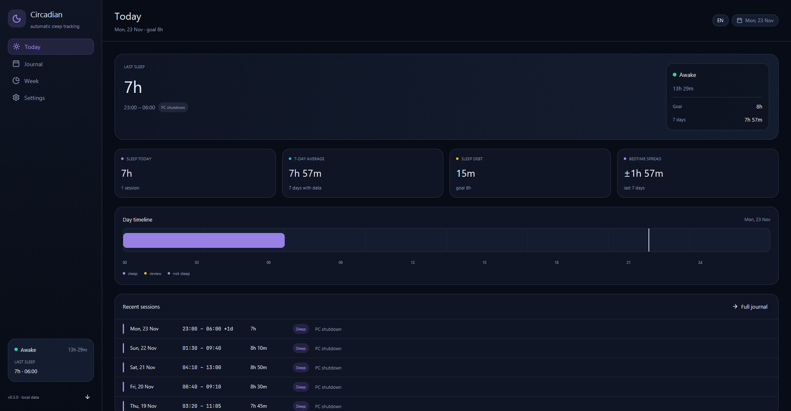
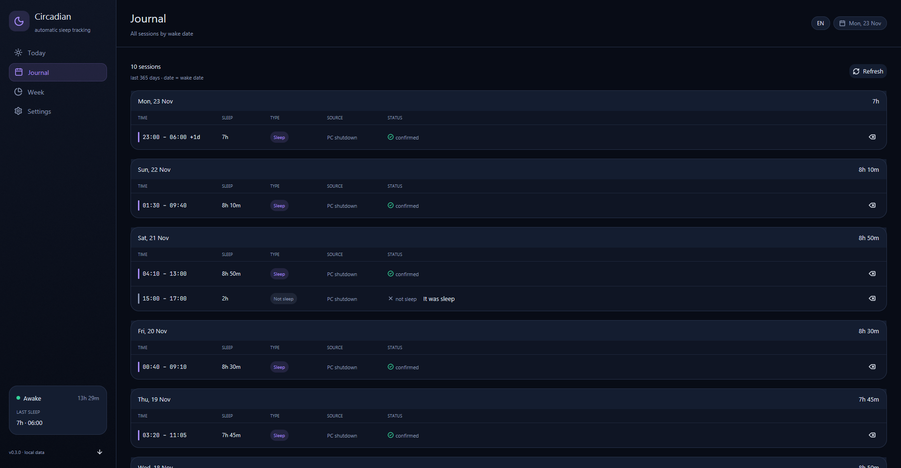
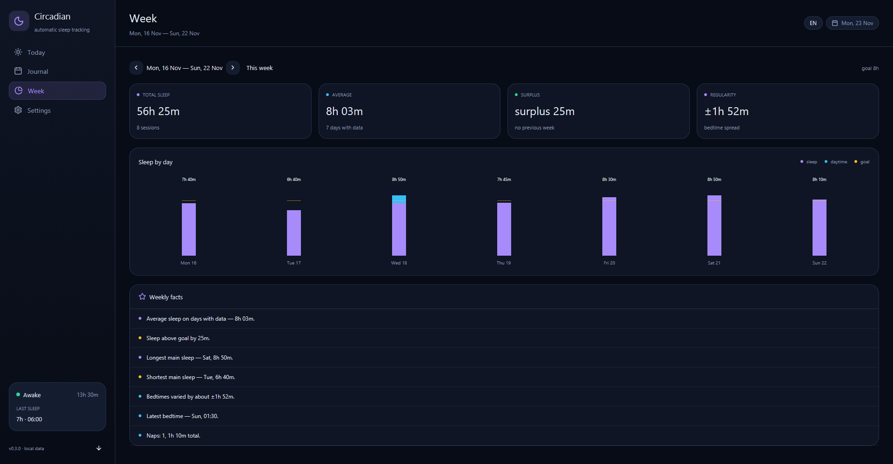
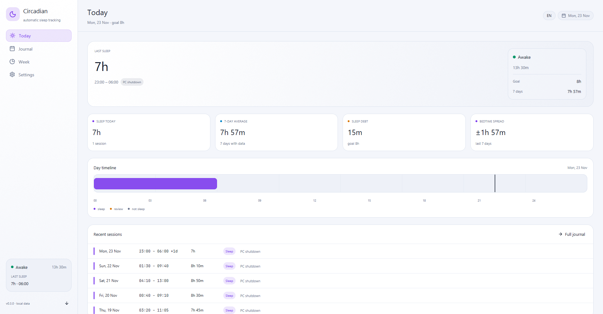

<p align="center">
  
</p>

<p align="center">
  <a href="#screenshots">Скриншоты</a> •
  <a href="#install">Установка</a> •
  <a href="#how-it-works">Как это работает</a> •
  <a href="#privacy">Приватность</a> •
  <a href="#faq">FAQ</a> •
  <a href="#build">Сборка</a> •
  <a href="README.md">English</a>
</p>

<p align="center">
  <a href="https://github.com/drawiks/circadian/releases/latest"></a>
  <a href="https://github.com/drawiks/circadian/actions/workflows/ci.yml"></a>
  
  <a href="LICENSE"></a>
</p>

Circadian — трекер сна для ПК. Выключи компьютер, когда идёшь спать, включи утром — и увидишь, сколько ты спал, накопился ли недосып и насколько стабилен график.

Без браслета, телефона и аккаунта. Все данные остаются на компьютере.

**[Скачать для Windows](https://github.com/drawiks/circadian/releases/latest)**

## Скриншоты

| Сегодня | Журнал |
|---|---|
|  |  |

| Неделя | Светлая тема |
|---|---|
|  |  |

Скриншоты сделаны на английском; язык интерфейса переключается кнопкой EN/RU в верхней панели.

## Что внутри

- **Автоматический трекинг.** Выключил ПК — отбой. Включил — подъём.
- **Без носимых устройств.** Не нужно заряжать браслет, класть телефон в кровать и регистрироваться.
- **Понятный отчёт.** Среднее за неделю, недосып, разброс отбоя, самый длинный и короткий сон, короткие факты.
- **Реальный ПК.** Ребуты, обновления Windows, сон, гибернация и пропажа питания учитываются.
- **Локально.** SQLite в `%LOCALAPPDATA%\Circadian`. Без телеметрии. Проверка обновлений — только по кнопке.
- **Нативный интерфейс.** Английский и русский, тёмная и светлая темы, трей, автозапуск.

## Как это работает

1. Ты выключаешь ПК, когда ложишься спать.
2. Circadian записывает момент выключения как начало сна.
3. При следующем включении сессия закрывается и появляется в журнале.

Если перерыв слишком короткий для сна, Circadian спросит, а не будет угадывать:

| Перерыв | Результат |
|---|---|
| Меньше 45 минут | Игнорируется: ребут, обновление, короткий уход |
| 45 минут – 4 часа | Нужно подтвердить: сон или не сон |
| 4 часа и больше | Считается сном |
| Сон ПК / гибернация | Считается сном, если перерыв достаточно длинный |
| Демон не работал | Пробел в данных, а не сон |

Сессия относится к **дню пробуждения**. Сон с 03:00 до 11:00 принадлежит 11-му числу. Несколько сессий и дневной сон поддерживаются.

## Установка

Скачай `Circadian-Setup-*.exe` из [Releases](https://github.com/drawiks/circadian/releases/latest). Установка идёт в `%LOCALAPPDATA%\Programs\Circadian` и не требует администратора.

Установщик не подписан, поэтому SmartScreen может предупредить. Нажми **Подробнее → Выполнить всё равно**.

Есть portable ZIP: распакуй в постоянную папку и запусти `circadian.exe`. Обновление ставится поверх и сохраняет историю. Удаление убирает программу, автозапуск и ярлыки, но историю сна оставляет, если не подтвердить её удаление.

Нужна Windows 10 версии 1903 или новее. Windows 11 поддерживается.

## Обновления

Установленная версия проверяет обновления по кнопке у версии в боковом меню. Установщик скачивается с GitHub, проверяется по подписанному манифесту и SHA-256, затем ставится поверх текущей версии. Настройки и история сна остаются в `%LOCALAPPDATA%\Circadian`.

Portable-версия обновляется вручную: скачай свежий ZIP и замени файлы.

Проверка обращается к GitHub только когда ты нажимаешь кнопку. Фоновой проверки, телеметрии и отправки данных о сне нет.

В сборках до 0.3.0 апдейтера нет. Один раз поставь 0.3.0 вручную, дальше обновления идут из приложения.

## Приватность

Данные о сне — личные. Circadian не создаёт аккаунт и не отправляет данные о сне на сервер. Он обращается к GitHub только когда ты проверяешь обновления или открываешь ссылку на релиз. Аналитики нет. История лежит в локальной базе:

```text
%LOCALAPPDATA%\Circadian\circadian.db
```

В настройках можно экспортировать все сессии в CSV и удалить базу. При удалении программы история остаётся, пока ты сам не подтвердишь её удаление.

## FAQ

**Почему данных ещё нет?**

Circadian начинает считать после первого выключения или сна ПК. До этого журнал пуст. Демон может работать в трее — вручную ничего вводить не нужно.

**Я не выключаю ПК, а усыпляю.**

Сон и гибернация учитываются, если перерыв достаточно длинный. Короткие перерывы считаются уходом.

**Ребут или обновление Windows.**

Ребуты короче 45 минут игнорируются. Долгое обновление может появиться как «проверить»; отметь его как «не сон».

**Где мои данные?**

`%LOCALAPPDATA%\Circadian`. Путь и кнопка экспорта есть в настройках.

**Куда-то отправляется?**

Данные о сне не отправляются. Нет аккаунта, облака и телеметрии. Circadian обращается к GitHub только когда ты проверяешь обновления.

**Это медицинский сервис?**

Нет. Circadian фиксирует время и паттерны, но не ставит диагноз и не лечит.

## Сборка

Release-сборка и установщик собираются на Windows.

<details>
<summary>Windows</summary>

```powershell
rustup toolchain install 1.98.1
cargo test -p circadian-core
cargo clippy --workspace --all-targets -- -D warnings
cargo build --release -p circadian-app -p circadian-daemon
```

Установщик собирается Inno Setup 6:

```powershell
winget install JRSoftware.InnoSetup
$iscc = Get-ChildItem `
  "${env:ProgramFiles(x86)}\Inno Setup 6\ISCC.exe", `
  "$env:LOCALAPPDATA\Programs\Inno Setup 6\ISCC.exe" `
  -ErrorAction SilentlyContinue | Select-Object -First 1
& $iscc "/DAppVersion=0.3.0" "/DBinDir=..\target\release" "installer\circadian.iss"
```

</details>

## Под капотом

Rust, [GPUI](https://gpui.rs), GPUI Kit и SQLite. Демон в трее использует Win32 power events и в простое занимает 0% CPU. Интерфейс нативный Direct3D — без WebView.

## Лицензия

MIT. См. [LICENSE](LICENSE). Сторонние компоненты и лицензии шрифтов — в [THIRD_PARTY_NOTICES.md](THIRD_PARTY_NOTICES.md) и папке [licenses](licenses/).

Если Circadian оказался полезен, звезда поможет другим найти проект.
